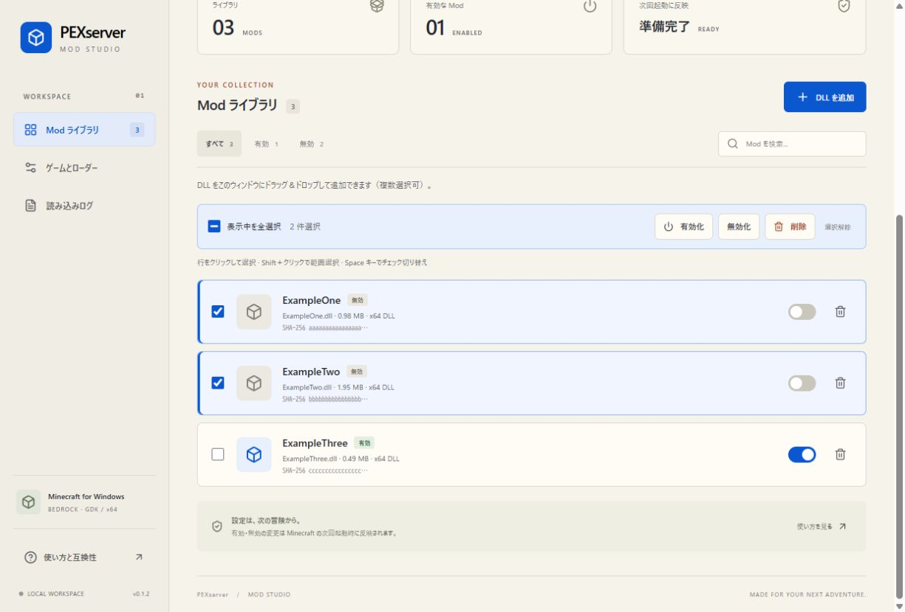

# PEX Mod Studio

Minecraft for Windows GDK 向けの DLL Mod マネージャー。Tauri 2 / React 19 / TypeScript / Rust。
PEXserver の renewal テーマを参考に、生成り色の紙・銅色の見出し・青いアクションを使用しています。

[Windows 版をダウンロード](https://github.com/gamelist1990/PEXModStudio/releases/latest) · [リリース一覧](https://github.com/gamelist1990/PEXModStudio/releases)



## 利用方法

1. Windows x64 のインストーラーを実行するか、ポータブル EXE を起動します。
2. 「ゲームとローダー」で Minecraft の場所を確認して「ローダーを導入」を押します。
3. お持ちの **Minecraft の現在の版に対応した x64 DLL** をアプリのウィンドウへドラッグ＆ドロップします。複数ファイルをまとめて追加でき、どの画面でも受け付けます。「DLL を追加」ボタンからの選択も利用できます。新規 Mod は無効で登録され、同名 DLL の更新では既存の有効・無効設定を維持します。
4. スイッチで有効にし、「Minecraft を起動」を押します。通常の Xbox アプリやショートカットからの起動にも自動読み込みが適用されます。Mod Studio の常駐は不要です。
5. 無効化はスイッチ、アンインストールはごみ箱ボタン。「ゲームとローダー」の「導入解除」で自動読み込み全体を解除できます。取り込み元 DLL とローカルライブラリは保持されます。

Minecraft の実行中は Mod の変更を停止します。DLL は実行中にアンロードせず、変更を次回起動へ反映します。

ドラッグ中は追加の可否を表示します。Minecraft 起動中・他の処理中・削除確認中は取り込みません。不正な DLL は拒否し、複数ファイルの一部が失敗しても残りの取り込みを続けて結果を表示します。ドラッグ＆ドロップは Windows アプリで利用できます。

## 複数選択と一括操作

- 各行のチェックボックス、またはボタン以外の行部分をクリックすると選択・解除できます。
- Shift＋クリックで範囲を選択・解除します。チェックボックスは Tab / Space キーでも操作できます。
- 「表示中を全選択」は、現在の検索・フィルターで表示されている項目だけを選択・解除します。
- 選択件数と一括操作の「有効化」「無効化」「削除」「選択解除」を表示します。削除には対象名と件数を示す確認画面があります。
- 検索・フィルターを変えても選択は維持され、選択済みで非表示になっている件数を表示します。一括操作の対象は非表示分も含む選択全体です。

## 同名 DLL の更新

同じファイル名の DLL を追加すると、既存 Mod の UUID・表示名・有効状態を維持して内容と SHA-256・サイズを更新します。ファイル名の英字の大文字・小文字違いも同一名として扱います。内容が同一の場合は「変更なし」と表示します。同じ内容を別名で追加することは拒否します。

元の DLL を検証してから置き換え、保存や配置に失敗した場合は元のライブラリ DLL・ゲーム側コピー・回復情報への復元を試みます。更新した Mod の古い初期化失敗記録は解除し、次回起動で再試行できます。以前の版で同名の別項目が複数登録されている場合は、誤更新を避けるため、不要な項目を削除してから更新する案内を表示します。

## 自動読み込み

Ultimate ASI Loader **10.0.0 x64 / winhttp.dll** を使います。独自ブリッジ `PEXModBridge.asi` の `InitializeASI` が、有効な DLL の一覧だけを読み込みます。`DontLoadFromDllMain=1` を固定し、ブリッジの初期化処理を Windows の loader lock の外で行います。Minecraft 本体 EXE やインポートテーブルは書き換えません。

追加するゲーム側のファイル:

```text
Content/
  winhttp.dll
  winhttp.ini
  .pex-mod-studio.json
  PEXMods/
    PEXModBridge.asi
    active.txt
    <mod UUID>/<元のファイル名>.dll
    loader.log
    loading.txt / blocked.txt  # 初期化失敗時の回復情報
```

ライブラリは `%LOCALAPPDATA%\com.pexserver.modstudio\library`、設定は同じ場所の `library.json` に保存します。DLL の元ファイルは変更しません。

`LOADED` は Windows が DLL をロードしたことを示します。DLL が狙うゲームのシンボル、フック、動作の互換性までは検証しません。初期化中にプロセスが終了した DLL は次の起動でスキップし、`blocked.txt` に保持します。修正済み DLL を再取り込みするか、いったん無効にして再度有効にすると再試行できます。初期化後のゲームプレイ中のクラッシュは自動特定できません。

既存の `winhttp.dll`・設定ファイルとは自動で共存しません。衝突を表示し、上書きを止めます。自分が導入したローダーも SHA-256 が変更されている場合は上書き・削除しません。欠けた管理対象ファイルは「構成を確認・同期」で修復できます。同時に別のツールでローダーを変更しないでください。

## 対応範囲

- Windows 10/11 x64、Minecraft Bedrock GDK。実機の `1.26.5203.0` で起動とゲーム内ブリッジ実行を確認。
- ローカルにある単体 `.dll` を取り込みます。配布元不明の Mod をネットから自動検索・ダウンロードする機能はありません。
- 追加データや別 DLL に依存する Mod、LeviLamina 専用プラグインには別途その環境が必要です。この版はそれらの依存関係をインストールしません。
- UWP 専用、x86、ARM64 の Mod は対象外。ゲーム更新後の DLL 互換性は各配布元で確認してください。
- ゲーム本体の保護・所有権・ライセンス認証・アンチチートは変更しません。
- アプリ自体を Windows からアンインストールする前に、必要なら「導入解除」を行ってください。ゲーム側のローダーは独立して動作します。

## 開発

Node.js 22.12 以降、Rust stable、Visual Studio C++ Build Tools、WebView2 が必要です。

```powershell
git clone https://github.com/gamelist1990/PEXModStudio.git
cd PEXModStudio
npm ci
npm run native
npm run tauri dev
```

```powershell
npm run build
node --experimental-strip-types --test tests/*.test.mjs
cargo test --manifest-path src-tauri/Cargo.toml
powershell -NoProfile -ExecutionPolicy Bypass -File scripts/test-bridge.ps1
npm run tauri build -- --bundles nsis
```

`scripts/prepare-native.ps1` は GitHub の固定アセット ID `662745698` を取得し、アーカイブの SHA-256 `422645c19da0cc5904170c81903a5a9c9a1384131496a295de870c8c1789f5be` を照合します。moving tag をビルドごとに追従しません。ブリッジは `native/` の Rust ソースからビルドします。生成したローダーはアプリ内へ埋め込み、アプリ利用時のダウンロードは不要です。

UI だけの確認は `npm run dev`。ブラウザでは実際のゲームを検出したようには表示せず、プレビューであることを明示します。

実ゲーム用の開発者向け検証ハーネスは `src-tauri/examples/game_smoke.rs` です。`--run-probe <Content> <probe.dll>` を明示した場合だけ動き、使い捨てライブラリの DLL を読み込ませ、テストで起動した Minecraft を終了して DLL を削除します。既存の有効 Mod や配置済み Mod フォルダがある場合は拒否します。通常利用には不要です。

二重起動は既存ウィンドウを前面に出し、複数プロセスからライブラリを同時に更新することを防ぎます。

## 調査した代替手段

- [QYCottage/ModLoader](https://github.com/QYCottage/ModLoader): 旧方式。ソースの `DllMain` から Mod を読み込みます。今回のクラッシュ原因を断定したものではありません。
- [Ultimate ASI Loader](https://github.com/ThirteenAG/Ultimate-ASI-Loader): 採用。汎用 x64 WinHTTP プロキシと loader lock 外の `InitializeASI` を使用。
- [LeviLauncher](https://github.com/LiteLDev/LeviLauncher): Minecraft GDK/UWP 向けの有力な別ランチャー。今回は Tauri アプリで現在の XboxGames インストールを管理するため、内部コードは転用していません。
- [PEXServerWebSite](https://github.com/gamelist1990/PEXServerWebSite): `src/renewal.css` のテーマを参照。

## ライセンス

同梱する Ultimate ASI Loader は MIT License。`docs/Ultimate-ASI-Loader-LICENSE.txt` と配布物の `THIRD_PARTY_NOTICES.txt` を参照してください。
